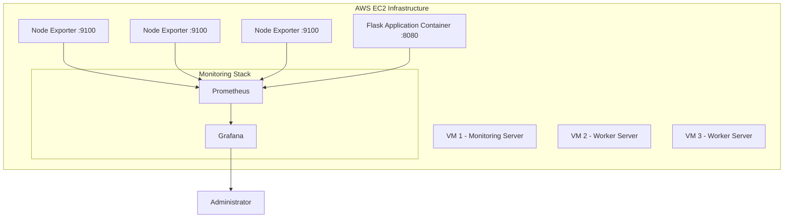

# Application Observability and Automated Alerting

A practical DevOps project implementing application monitoring, metrics collection, visualization and automated alert detection using **Prometheus, Grafana, Docker, Flask and AWS EC2**.

## Project Overview

This project demonstrates how to monitor a containerized Flask application and multiple AWS EC2 instances using an integrated observability stack.

Prometheus collects application and infrastructure metrics, Grafana visualizes them through dashboards, and Prometheus alerting rules detect abnormal application error rates and high CPU utilization.

The implementation uses three EC2 instances for infrastructure monitoring and a separate Flask application container for application-level observability.

## Architecture



### Infrastructure Configuration

| Component | Responsibility |
|---|---|
| VM 1 | Prometheus, Grafana and Node Exporter |
| VM 2 | Node Exporter |
| VM 3 | Node Exporter |
| Flask container | Application metrics and HTTP endpoints |
| Prometheus | Metrics collection and alert evaluation |
| Grafana | Monitoring dashboards and visualization |

## Technology Stack

| Technology | Purpose |
|---|---|
| AWS EC2 | Cloud infrastructure |
| Ubuntu | Operating system |
| Docker | Containerization |
| Python | Application development |
| Flask | Web application |
| Prometheus | Metrics collection and alerting |
| Node Exporter | Infrastructure metrics |
| Grafana | Metrics visualization |
| Git and GitHub | Version control |

## Application Instrumentation

The Flask application exposes four endpoints:

| Endpoint | Description |
|---|---|
| `/` | Application health response |
| `/slow` | Simulates a slow HTTP response |
| `/error` | Generates an HTTP 500 response |
| `/metrics` | Exposes Prometheus metrics |

### Custom Prometheus Metrics

**1. Counter — `http_requests_total`**

Tracks total HTTP requests using the following labels:

- HTTP method
- Endpoint
- HTTP status code

**2. Gauge — `active_connections`**

Tracks the number of HTTP requests currently being processed. It represents active requests, not persistent TCP connections.

**3. Histogram — `http_request_duration_seconds`**

Measures HTTP request processing duration and provides latency distribution buckets.

## Prometheus Configuration

Prometheus is configured with:

- Scrape interval: 5 seconds
- Evaluation interval: 5 seconds
- Prometheus self-monitoring
- Three Node Exporter targets
- Flask application metrics endpoint

Application metrics are collected from:

```text
web-app:8080/metrics
```

## Grafana Dashboard

The exported dashboard is available in:

[`grafana/application-observability-dashboard.json`](grafana/application-observability-dashboard.json)

### Dashboard Panels

1. HTTP Request Rate
2. HTTP Error Rate
3. Active HTTP Requests
4. Average Request Latency
5. P95 Request Latency

Grafana uses Prometheus as its data source.

## Automated Alerting

Two Prometheus alerting rules were implemented.

### HighErrorRate

- Condition: HTTP 500 error rate exceeds 5%.
- Evaluation duration: 30 seconds.
- Severity: Critical.

### HighCpuUsage

- Condition: CPU utilization exceeds 80%.
- Evaluation duration: 1 minute.
- Severity: Warning.

The application error alert was tested by generating HTTP 500 responses through the `/error` endpoint.

## Repository Structure

```text
application-observability-prometheus-grafana/
│
├── app/
│   ├── Dockerfile
│   ├── main.py
│   └── requirements.txt
│
├── prometheus/
│   ├── prometheus.example.yml
│   └── rules/
│       └── alert_rules.yml
│
├── grafana/
│   ├── README.md
│   └── application-observability-dashboard.json
│
├── docker-compose.example.yml
└── .gitignore
```

## Deployment and Configuration

The project was implemented using an existing three-VM monitoring infrastructure.

The repository contains example configuration files. Before reproducing the deployment:

1. Configure the EC2 instances and networking.
2. Install Docker on the required instances.
3. Deploy Node Exporter on each monitored instance.
4. Configure Prometheus scrape targets.
5. Deploy Prometheus and Grafana.
6. Build and deploy the Flask application container.
7. Configure the application metrics endpoint.
8. Load the Prometheus alert rules.
9. Import the Grafana dashboard JSON.
10. Generate application traffic and verify metrics and alerts.

**Configuration note:** The example Compose file deploys Prometheus and Grafana. The Flask application and Node Exporter deployment must also be configured and connected to the appropriate monitoring network.

## Testing and Validation

The following functionality was tested during implementation:

- Flask application HTTP response.
- Simulated slow HTTP requests.
- HTTP 500 error generation.
- Prometheus metrics endpoint.
- Prometheus target connectivity.
- Node Exporter metric collection.
- Grafana dashboard visualization.
- Prometheus alert rule validation.
- High HTTP error rate alert activation.

## Learning Outcomes

Through this project, I gained practical experience with:

- Infrastructure monitoring across multiple EC2 instances.
- Application instrumentation using Prometheus Client.
- Metrics collection and PromQL queries.
- Docker container networking.
- Grafana dashboard development.
- Prometheus alert rule configuration.
- Troubleshooting monitoring infrastructure.
- Git-based project management and documentation.

## Future Improvements

- Integrate Alertmanager for notification delivery.
- Add application container deployment to Docker Compose.
- Implement CI/CD using Jenkins.
- Introduce centralized logging using Loki.
- Add more application performance metrics.
- Improve dashboard design and monitoring coverage.

## Author

**MRDOM12**

GitHub: https://github.com/MRDOM12

---

*This project was developed as a hands-on DevOps learning project focused on application observability and infrastructure monitoring.*
